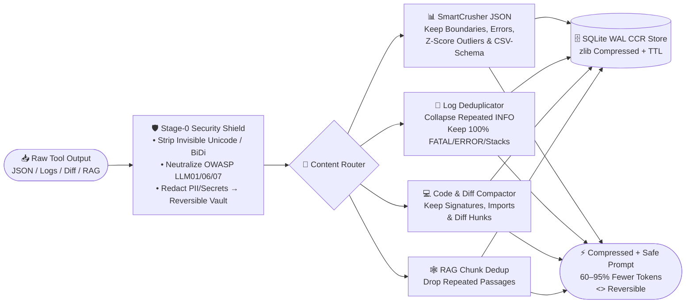

<div align="center">

# ⚡ Headroom Shield — Zero-Dependency LLM Context Compressor + OWASP Security Shield

[](https://wallisonws.github.io/headroom-shield/)
[-10b981?style=for-the-badge)](#)
[](#)
[](LICENSE)

<p align="center">
  <a href="README.md"></a>
  <a href="README.pt-BR.md"></a>
  <a href="docs/ARCHITECTURE.md"></a>
  <a href="docs/MCP_AND_PROXY_GUIDE.md"></a>
</p>

**Compress JSON arrays, logs, diffs, code & RAG chunks by 60–95% BEFORE they reach Gemini, Claude or OpenAI — with a built-in OWASP LLM Prompt-Injection Shield, Reversible PII/LGPD Vault, Zero-Dependency MCP Server, Local Proxy & Live Browser Studio.**

*Modeled & enhanced via [REA (Reverse Engineer Anything)](https://github.com/morluto/rea) static & SQLite inspection of [`headroomlabs-ai/headroom`](https://github.com/headroomlabs-ai/headroom) (Apache-2.0).*

</div>

---

## 🔥 Why Headroom Shield? (Key Improvements Over Upstream Headroom OSS)

During our architectural & REA audit of `headroomlabs-ai/headroom`, we identified 5 high-friction gaps for developers, security teams, and air-gapped environments — and engineered **Headroom Shield** to solve every single one:

| Capability | Upstream Headroom OSS | ⚡ **Headroom Shield** |
| :--- | :--- | :--- |
| **Runtime Dependencies** | Hard Rust PyO3 wheel (`headroom._core`), `mcp`, `httpx`, optional PyTorch/ONNX | **Zero external dependencies** (Pure Python 3 stdlib + Zero-dep JS ESM + Native PowerShell) |
| **Telemetry Beacon** | Anonymous usage beacon **ON by default** (`HEADROOM_BEACON`) | **100% Air-Gapped / Zero Telemetry by default** (zero outbound phone-home) |
| **Prompt-Injection & PII Security** | *"Tokens secured"* reserved for paid Enterprise tier | **Built-in Stage-0 OWASP LLM Shield + Reversible PII/LGPD Vault** (Open Source!) |
| **CCR SQLite Store Disk Usage** | Plaintext `entry_json` in `ccr_entries` (`ev_7a5078f1...`) | **Schema-compatible SQLite WAL + zlib compression** + automatic TTL pruning |
| **Interactive Browser Studio** | None (CLI/Proxy only) | **Live Trilingual Web Workbench (EN / PT-BR / ES)** with CCR retrieval & USD savings |

---

## 🧭 Compression & Security Pipeline



---

## 🚀 Quick Start (Zero Installation Required)

```bash
git clone https://github.com/WallisonWS/headroom-shield.git
cd headroom-shield
```

### 1️⃣ Python Library (Zero External Packages)
```python
import json
from headroom_shield import CCRStore, compress_content

store = CCRStore("ccr_store.db")
rows = [{"id": i, "status": 200, "latency_ms": 12} for i in range(150)]
rows[64] = {"id": 64, "status": 500, "error": "FATAL DB pool exhausted for maria@corp.com"}

result, audit = compress_content(json.dumps(rows), store=store, security_shield=True, redact_pii=True)
print(f"{result.tokens_before} -> {result.tokens_after} tokens (-{result.savings_percent}%)")
print("CCR Hash:", result.ccr_hash)
print("Original restored:", len(json.loads(store.retrieve(result.ccr_hash)["content"])), "rows")
```

### 2️⃣ Standalone Zero-Dependency MCP Server (Antigravity, Claude Code, Cursor, Codex)
```bash
python3 -m headroom_shield.mcp_server
```
Exposes `headroom_compress`, `headroom_retrieve`, `headroom_stats`, and `headroom_security_audit` over standard JSON-RPC 2.0 `stdio`! See [docs/MCP_AND_PROXY_GUIDE.md](docs/MCP_AND_PROXY_GUIDE.md).

### 3️⃣ Local HTTP Proxy (OpenAI / Anthropic / Gemini — Zero Telemetry)
```bash
python3 -m headroom_shield.proxy_server --port 8787 --upstream https://api.openai.com
```

### 4️⃣ JavaScript / TypeScript ESM SDK (`sdk/headroom-shield.mjs`)
```javascript
import { compress } from './sdk/headroom-shield.mjs';
const res = compress(rawToolOutput, { securityShield: true, redactPii: true, csvSchema: true });
console.log(res.savingsPercent, res.ccrHash, res.threats);
```

### 5️⃣ Native Windows PowerShell CLI (`headroom_shield.ps1`)
```powershell
.\headroom_shield.ps1 -FilePath .\server.log
```

---

## 🏢 Enterprise & Cloud SDK Packaging (`v1.1.0`)

Built for frictionless adoption inside **Google Cloud (Gemini / Vertex AI)**, **Microsoft Azure OpenAI**, and hardened Kubernetes clusters:

* **Standard Python Packaging (`pyproject.toml`):** `pip install -e .` installs `headroom-shield` & `headroom-shield-mcp` CLI entrypoints with **zero third-party runtime dependencies**.
* **TypeScript & Node.js ESM (`package.json` + [`sdk/headroom-shield.d.ts`](sdk/headroom-shield.d.ts)):** Full strict TypeScript declarations out of the box.
* **CIS-Hardened Non-Root Container ([`Dockerfile`](Dockerfile)):** Runs as unprivileged `headroom` user (`UID 10001`) with built-in `/health` check and air-gapped defaults.
* **Cloud AI Reference Examples:**
  * Google Gemini / Vertex AI Pipeline → [`examples/google_gemini_vertex_ai.py`](examples/google_gemini_vertex_ai.py)
  * Microsoft Azure OpenAI Enterprise Agent → [`examples/microsoft_azure_openai_agent.py`](examples/microsoft_azure_openai_agent.py)
* **Architecture Decision Record:** [`docs/ADR-001-architecture.md`](docs/ADR-001-architecture.md)

---

## 🧪 Run Unit Tests
```bash
python3 -m unittest discover -s tests -p "test_*.py" -v
```

---

## 📜 Attribution & License
Licensed under **Apache License 2.0** ([LICENSE](LICENSE)). Inspired by the context-compression & CCR architecture of [`headroomlabs-ai/headroom`](https://github.com/headroomlabs-ai/headroom) (see [NOTICE](NOTICE) and [docs/ARCHITECTURE.md](docs/ARCHITECTURE.md)).
